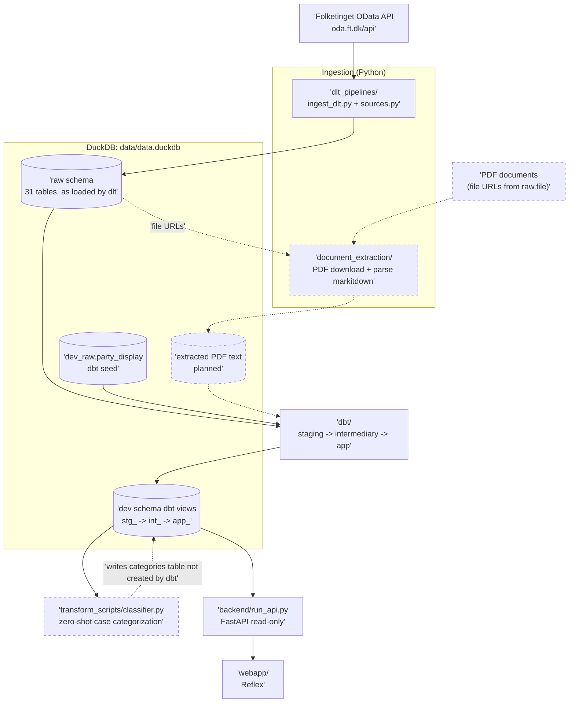

# Danish Politician Votes — Architecture

High-level architecture of the application. Per Constitution Principle V, this file is updated with every feature; feature-level (low-level) diagrams live in `specs/<feature>/plan.md`.

## Overview

The application loads voting data from the Danish Parliament (Folketinget) OData API into DuckDB (ELT), transforms it with dbt, and serves it through a FastAPI backend to a Reflex web app. A PDF ingest pipeline for case documents is specified but not yet built.

## High-Level Diagram

Solid boxes exist today. Dashed boxes are planned (see `specs/001_pdf_ingest_pipeline/spec.md`) or not yet working (see [Known Gaps](#known-gaps)).



## Components

| Component | Path | Responsibility |
|-----------|------|----------------|
| dlt sources | `dlt_pipelines/sources.py` | One `rest_api_source` per OData entity group: `actors`, `votes`, `cases`, `meeting`, `relations`, `document`. |
| Pipeline runner | `dlt_pipelines/ingest_dlt.py` | CLI that runs a source (or `all`) into `data/data.duckdb`, schema `raw`. One dlt pipeline per source (`ft_dk_<source>`). |
| dbt project | `dbt/` | All transformations. Layers: `staging` (`stg_`, light casting and renaming), `intermediary` (`int_`, joins and logic), `app` (`app_`, models consumed by the API). Seed: `party_display.csv`. |
| API | `backend/run_api.py` | FastAPI app with a read-only DuckDB connection. Endpoints: `GET /polls/latest` (paginated), `GET /votes/{actor_id}`. |
| Web app | `webapp/` | Reflex app. Fetches polls from the API and renders poll cards with donut charts. Party colors are defined in `webapp/states/poll_outcome_state.py`. |
| Classifier | `transform_scripts/classifier.py` | Zero-shot classification (Hugging Face `transformers`) of cases into the categories in `backend/configs/categories.yml`. |
| PDF extraction | `document_extraction/` | Work in progress: rate-limited download (5 req/s) and markitdown parsing. Methods are stubs. |
| DB helper | `utils/db_connection.py` | Thread-safe singleton DuckDB connection used by PDF extraction. |
| Exploration | `exploration/` | Notebooks. Not part of the application. |

## Data Flow and Layers

1. **Load (raw)** — dlt loads OData entities into the `raw` schema, one table per resource (e.g. `raw.actors`, `raw.case`, `raw.file`). Large entities load incrementally on `opdateringsdato` (initial value 2020-01-01) with `merge` and primary key `id`. Small lookup tables (types, statuses) are merged on every run. Raw tables are never modified after loading (Principle III). dlt also creates `raw_staging` for its own load staging; do not read from it.
2. **Transform (dbt)** — dbt reads `raw` sources and builds views in the `dev` schema: `stg_*` → `int_*` → `app_*`.
3. **Serve** — the API reads `dev.app_*` views read-only. The web app calls the API only; it never touches the database.

## Architecture Decisions

| Decision | Why | Upside | Downside |
|----------|-----|--------|----------|
| dlt for OData ingestion | Declarative config replaces custom pagination, schema, and state handling. | Little code per endpoint; built-in incremental loading and schema evolution. | Less control over request details; the OData date filter syntax has to be spelled out per resource. |
| DuckDB single file (`data/data.duckdb`) | Embedded OLAP, works with dlt and dbt, no server to run. | Simple setup, fast analytics. | One writer at a time: the API holds the file open read-only, so dlt/dbt runs and the API can conflict. Not suited to hosting multiple writers. |
| ELT with dbt, raw immutable | Keeps data auditable and allows reprocessing when logic changes. | Logic changes need no re-download. | Storage duplication across layers. |
| dbt models as views | Data volume is small and views are always current. | No refresh step. | Query cost grows with model depth; revisit if API latency becomes a problem. |
| API separate from web app | The frontend stays independent of storage. | The DB can change without touching the UI. | Two processes to run locally. |
| Custom Python for PDFs (not dlt) | PDFs need download, rate limiting, and parsing that dlt does not cover. | Full control over retry and skip logic. | Must implement idempotency and traceability (PDF file and page) ourselves. |

## Running

All commands use `uv`. Run dbt from `dbt/`.

```bash
uv sync

# Ingest
uv run python -m dlt_pipelines.ingest_dlt --list
uv run python -m dlt_pipelines.ingest_dlt all
uv run python -m dlt_pipelines.ingest_dlt actors --resources actors actor_types

# Transform
cd dbt && uv run dbt build

# Serve (two processes)
uv run uvicorn backend.run_api:app --port 5000 --reload
uv run reflex run
```

See `README.md` for the CLI arguments and the full list of sources and resources.

## Testing

Per Constitution Principle IV, every task lists its tests and all must pass before it is done.

| Layer | Command | Status |
|-------|---------|--------|
| Plain Python | `uv run pytest tests/document_extraction_tests` | Exists (`DBConnection`). |
| Ingestion | `uv run pytest tests/pipeline` | Directory does not exist yet. |
| API | `uv run pytest tests/api` | Directory does not exist yet. |
| dbt | `cd dbt && uv run dbt test` | Only source tests in `_*__sources.yml` and `app_votes.yml`. |

## Known Gaps

Differences between the code and the constitution or between components. They need a feature (spec → plan → tasks) to fix.

- **No ingestion or API tests.** `tests/pipeline` and `tests/api` do not exist (Principle IV).
- **`GET /votes/{actor_id}` is broken.** It queries `raw_app.app_votes`, which does not exist; `dbt/models/app/app_votes.yml` has no matching SQL model. It also builds SQL with an f-string; use query parameters.
- **Classifier output table is missing.** `classifier.py` reads `dev.stg_case` and writes `dev.stg_case_cat_zeroshot` and `dev.stg_case_scores_raw`. No dbt model or dlt resource creates them, and writing into the dbt schema blurs the raw/transform boundary (Principle III).
- **Hardcoded paths.** `dbt/profiles.yml` uses an absolute path to `data/data.duckdb`. `backend/configs/database.py` defines `DB_PATH`, which `run_api.py` does not use.
- **PDF extraction is incomplete.** `document_extraction/` has stubs only and no idempotency or traceability yet.
- **Single-file lock.** The API opens the database read-only for the whole process lifetime, which can block `dbt`/`dlt` writes.

## References

- [dlt docs](https://dlthub.com/docs)
- [dbt-duckdb](https://github.com/duckdb/dbt-duckdb)
- [Folketinget OData API](https://oda.ft.dk/api)
- [Reflex docs](https://reflex.dev/docs)
